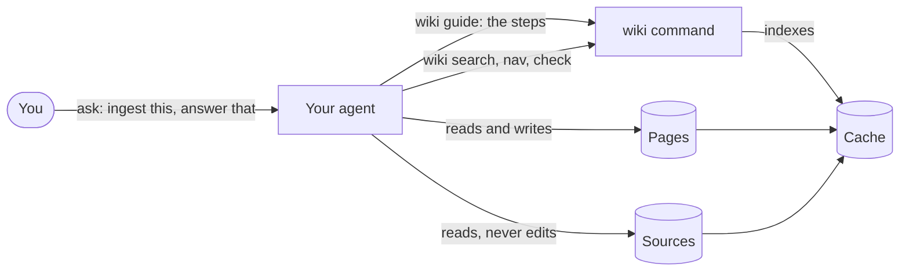

# Concepts

How the pieces fit, and what each term in the other docs means. Read this once; the rest
of the docs assume it.

## The idea

An **LLM wiki** is a folder of Markdown pages that an AI agent writes and keeps up to
date, from sources you give it or code it reads. You talk to the agent; the agent does
the writing. Because the knowledge lives in files rather than in a chat, it builds up
across sessions, and any agent can pick it up.

This kit gives that agent three things:

1. **Steps to follow.** `wiki guide ingest` prints how to add a source, `wiki guide
   query` how to answer a question, and so on. The steps ship with the tool, so every
   wiki gets improvements when you upgrade it.
2. **A way to find things** without reading the whole wiki: search that returns the best
   few pages for a question, and navigation that follows links by their stated reasons.
3. **Checks** that catch what agents get wrong: missing sections, uncited sources, broken
   links, pages that no longer match the code.



The `wiki` command never writes the content of a page: that is the agent's job. It
writes setup files (`wiki new`, `wiki init`, `wiki connect`), weekly notes, a page's
`verified:` when a code task finishes, and its own cache. It calls no AI model and uses no network, apart
from `wiki models download`.

## The parts of a wiki

**Wiki.** A folder holding pages and a `.wiki-cli.toml`. Commands find it the way git
finds a repository: by walking up from the current folder to the nearest config.

**Page.** One Markdown file: frontmatter (`title:`, `type:` and other fields), a
`## Summary`, and sections. Which files are pages is up to the config's `pages` globs.

**Slug.** A page's name in links: its file name without `.md`. `[[edith-thorne]]` links
the page `edith-thorne.md`. When two files share a name, the link needs a path
(`[[people/edith-thorne]]`), and `wiki check` warns until it has one.

**Summary.** The paragraph under `## Summary` (or a frontmatter field, or the first
paragraph). Search results and navigation show it, so it decides whether a page gets
opened.

**Page type.** What a page is about: a person, a module, a scene. It comes from the
page's `type:`, or from the folder it is in. Each type is declared in the config with a
description (which tells the agent when to use it), a folder, a template, and the
sections and fields its pages must have.

**Template.** The file a new page of a type starts from, in `templates/`.

**Source.** Material the wiki is built from, kept in `raw/`: a PDF, a saved article, a
transcript. Sources are never edited. A page records each one, and every fact cites the
source it came from. `wiki pending` lists sources that no page records yet.

**Original** (writing wikis). A piece you wrote yourself, in `originals/`: an idea, a
scene, a chapter. The agent reads originals and never changes them; each one gets a page
in the wiki.

**Record** (code wikis, mostly). A page about something that lives and changes in
another system, such as a ticket. It names the item by `key:` and `url:`, and records in
`synced:` when it was last read.

**Preset.** The starting files `wiki new` lays down for one kind of wiki: `research`,
`code` or `writing`. They are the wiki's own files afterwards. [presets.md](presets.md)
has each one.

## Links and relations

**Relation.** Every link between two pages is a relation. By default it is `links-to`,
with the sentence around the link as its **reason**.

**Typed relation.** A rule in the config gives the links in one place a name. Links
listed under a page's `## Relationships` heading, for example, become `associated-with`,
and the text after each link becomes the reason:

```markdown
## Relationships
- [[ruth-marsh]] — owned the mill whose night shift she ran
```

becomes `associated-with -> ruth-marsh`, reason "owned the mill whose night shift she
ran". Each relation also has an **inverse**, its name seen from the other page.
Navigation shows these reasons, so the agent can choose which page to open next without
opening them all. `wiki neighbors <slug>` lists a page's relations.

**Hub.** A page type that other pages gather around: a concept, an event, a module, a
plotline. Marking a type as a hub tells `wiki clusters` that a group of pages linking to
one is already covered.

**Cluster.** A group of pages that link each other densely. `wiki clusters` reports the
clusters no hub covers, which usually means something the pages share has no page of its
own yet.

**Group.** A part of the wiki that pages name in a field: a project, a client, a book.
`--group` on `wiki clusters` and `wiki map` looks at one part at a time.

## Agents and workflows

**Agent.** Whatever AI tool you work with: Claude Code, Codex, Cursor, Copilot, OpenCode.
The kit works with any agent that can run shell commands and read `AGENTS.md`.

**`AGENTS.md`.** The agent's instructions for this wiki: its role, the workflows, and
your own rules (in its "Your rules" section).

**Workflow.** A repeated job: ingest a source, answer a question, lint the wiki, sync a
code wiki after the code changed, do a task on the code. [workflows.md](workflows.md)
walks through each from your side.

**Guide.** A workflow's steps for the agent, printed by `wiki guide <name>`. Each preset
has its own variant of some guides. [guides.md](guides.md) has the reference.

**Part.** The wiki's own text for one step of a guide, such as how to fetch a ticket.
The guide prints it at that step, so the rest of the guide still updates with the tool.

**Adapter.** Files that connect one agent more closely: slash commands or skills that
pull a guide in (`/wiki-ingest`), and permissions to run `wiki`. `--agent` on `wiki new`
writes them. Without them, `AGENTS.md` still works.

## Search and navigation

**Search.** `wiki search` finds the best few pages for a question. It runs keyword search
and meaning-based (vector) search, combines them, and reranks the top passages with a
second model. Both models run on your machine.

**Navigation session.** How an agent answers a question while reading as little as
possible: `wiki nav start` searches, `nav read` shows the best-matching section of one
page, `nav candidates` lists where that page leads with each link's reason, and
`nav end` records which pages the answer cites. A session allows a limited number of
pages, and every read needs a stated reason. [navigation.md](navigation.md) shows one.

**Cache.** Everything the command builds for search: the index of pages, their
relations, and their embeddings. It lives in `.cache/` inside the wiki and can be deleted
at any time; `wiki index refresh` updates it, `wiki index rebuild` recreates it.

**Embedding.** A page section turned into numbers by a model, so that sections about the
same thing sit close together. Vector search and `wiki map` use them.

## Code wikis

**Code repo.** The repository the wiki describes. The wiki lives beside it or in a folder
of it, and records where it is.

**`code:` link.** A link from a page to a file in the code repo:
`[the scheduler](code:src/scheduler.py)`. `wiki check` warns when the file is gone.

**`covers:`.** The files a page describes, as globs. `wiki covering <file>` turns this
around: the pages that cover a file.

**`verified:`.** The code commit a page was last checked against. `wiki stale` lists the
pages whose covered files changed since.

**Task.** One piece of work on the code, run with `wiki guide work`: planned, approved,
done, and finished with `wiki finish`, which commits the code and then the wiki. With the
code repo connected, edits are refused outside a task, and from any session but the one
running it.

**Decision.** A page recording why something is the way it is. The agent writes each one
as `status: proposed`; only you accept it.

## What the kit does not do

- **Write pages by itself.** Without an agent, nothing gets written. The kit makes the
  agent's work consistent; it does not replace the agent.
- **Contact other services.** It never calls an AI model, a tracker, a forge or a
  website. The agent fetches what it needs with its own access.
- **Host or display the wiki.** The wiki is plain files: read it in Obsidian, an editor,
  or on GitHub. `wiki map` is the only page it draws.
- **Sync between machines.** Git does that; every workflow ends in a commit.
- **Describe more than one code repo per wiki,** for now.
- **Search well in languages other than English.** The default models are English ones.

Search runs on the CPU: indexing takes about 2 minutes per 500 pages the first time, and
a fraction of a second afterwards for unchanged pages.

---

**Next:** [Workflows](workflows.md): what you do with a wiki, step by step. · [All docs](README.md)
